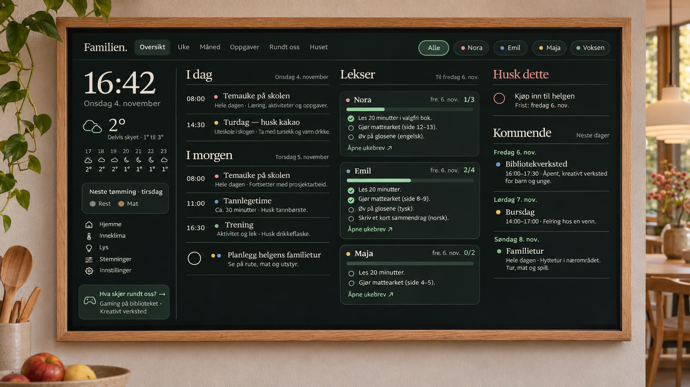
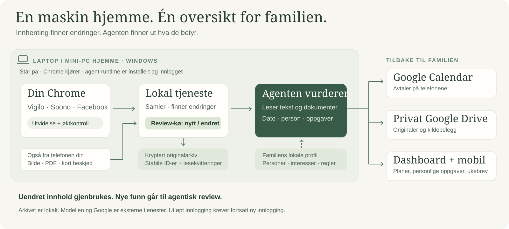

# Familien · Family Assistant

**Fra spredte skolemeldinger til en plan familien kan bruke.**

Familien leser Vigilo, Spond, relevante Facebook-grupper og det dere sender inn fra telefonen. Agenten finner datoer, lekser og ting som må huskes — og oppdaterer familiekalenderen og personlige oppgaver, med originalen tilgjengelig.



Designet rundt en **vakker 24-tommers touchskjerm, 16:9 i Full HD**, på et sentralt sted i huset. Et rolig, felles holdepunkt i hverdagen: i dag, i morgen og det som kommer — med personlige oppgaver, ukeplaner og kalender ett trykk unna. Telefonen gir samme familieoversikt og en rask vei inn med bilder og beskjeder.

En ukeplan med «turdag tirsdag — husk kakao» blir en kalenderoppføring med pakkeliste og lenke til ukeplanen. Søsken kan ha samme lekseplan og likevel krysse av oppgavene hver for seg.

## Slik fungerer det



1. **En egen maskin står på hjemme.** En Windows-laptop eller mini-PC kjører den lokale tjenesten fra dette repoet, Chrome og en innlogget ChatGPT/Codex-runtime.
2. **Utvidelsen følger kildene.** Chrome beholder familiens innloggede nettleserprofil. Utvidelsen samler fra portalene, beskytter Vigilo-fanen mot minneutlasting og kontrollerer øktene. Facebook krever også at innholdet faktisk lastes i nettleseren.
3. **Nytt og endret går til review.** Tjenesten lagrer originaler og legger arbeidet i kø. Agenten leser innholdet, bruker familieprofilen og vurderer hvem det gjelder og hva som må gjøres. Kjente ID-er og lesekvitteringer gjør at samme dokument ikke behandles om igjen uten grunn.
4. **Familien får resultatet.** Avtaler havner i Google Calendar, originaler i privat Drive og oppgaver på dashboard og mobil. Bilder, PDF-er og korte telefonbeskjeder går inn i samme flyt og behandles så snart agenten er ledig.

Review er agentens gjennomgang; vanlige kalenderfunn trenger ikke en ekstra manuell godkjenning. Forslag til fritidsaktiviteter blir først avtaler når familien velger dem.

**Hva skjer rundt oss?** Agenten gjennomgår også kommunale arrangementskalendere, bibliotekprogrammer, kulturhus, museer, lokale Facebook-grupper og arrangørsider. Gamingkvelder, kreative verksteder, konserter, teater, teknologiaktiviteter og loppemarkeder vurderes mot akkurat deres familieprofil: alder, interesser, preferanser og praktiske rammer. Resultatet er personlige forslag med korte, fristende beskrivelser — noe familien kan glede seg til sammen.

Øktkontrollen reduserer avbrudd, men portalene kan fortsatt kreve ny innlogging. Systemet viser slike hull. Arkivet er lokalt og kryptert; modellen og Google er eksterne tjenester.

## Prøv med din familie

Krever **Windows, Node.js 24+, Chrome og egen agent-/modelltilgang**. Telefoner og eventuell Raspberry Pi-skjerm er visninger; maskinen hjemme gjør arbeidet.

```powershell
git clone https://github.com/jorron87/family-assistant.git
cd family-assistant
npm ci
npm run setup
npm run doctor
npm start
```

Åpne [familievisningen](http://127.0.0.1:4318). Følg [oppsettet](docs/setup.md) for egen profil, Chrome-utvidelse, Google og én manuell prøve før automatikk aktiveres. Din agent kan starte med [AGENTS.md](AGENTS.md). Ingen innlogginger eller ekte familiedata følger med.

En touchskjerm kan vise oversikten fast. Mobilinnsending utenfor hjemmet bruker egen HTTPS-tunnel. Home Assistant, vær, renovasjon og lokale aktivitetsforslag er valgfrie tillegg.

**Handel** er et valgfritt tillegg for Oda-historikk, prisovervåkning og lokale tilbud på varer familien allerede kjøper. Dashboardet viser anslått besparelse i kroner, pakningsstørrelser, vilkår og kilde. Oda kobles til med familiens eget samtykke; valgte varer kan legges i kurven, mens familien ser over og betaler hos Oda. Historikk fra én butikk er bare en del av forbruket. [Oppsett](docs/setup.md) og [kommandoer](docs/runbook.md) beskriver aktivering og manuell verifisering.

[Arkitektur](docs/architecture.md) · [Integrasjoner](docs/integrations.md) · [Utvikling og Git](docs/git-workflow.md) · [Personvern](SECURITY.md) · [Bidra](CONTRIBUTING.md)

MIT-lisens. Uoffisielle kildeintegrasjoner; grensesnitt og datotolkning er foreløpig primært norske.
