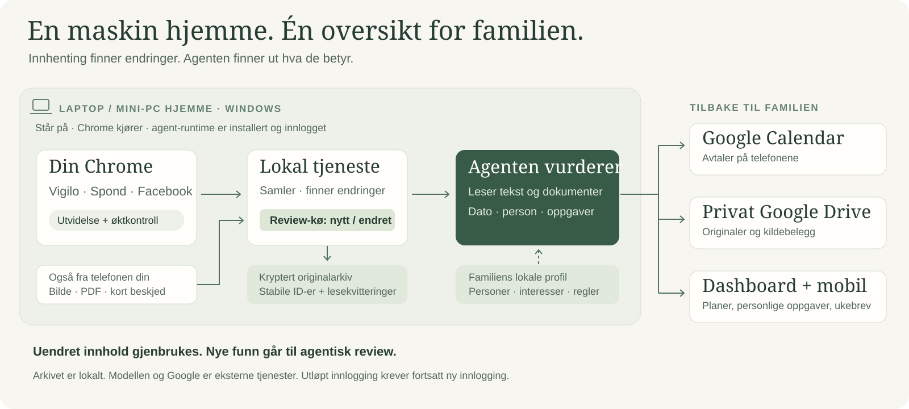
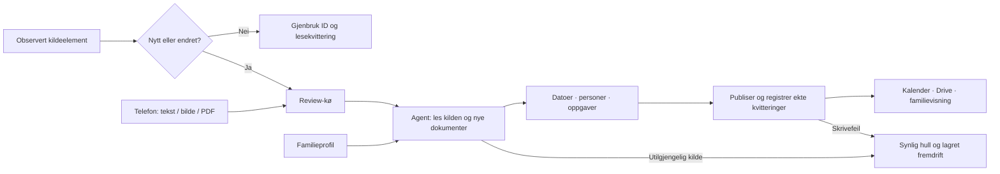

# Arkitektur

## Maskinen hjemme er motoren

En egen Windows-laptop eller mini-PC må stå på for at innhenting og behandling skal kjøre. Den lokale Node-tjenesten startes under husholdningens Windows-bruker og kjører koden fra repoets checkout. Chrome må kjøre med riktig profil og innloggede kildefaner. En installert, innlogget ChatGPT/Codex-runtime utfører agentarbeidet med familiens valgte modell og verktøytilgang. En åpen webside på telefonen erstatter ikke disse prosessene.

Familiemedlemmer, kildegrupper, kalender, Drive-mottakere og agentvalg er lokal konfigurasjon. Det krypterte arkivet, varige lesekvitteringer og familiens avkryssinger ligger utenfor Git. Generelle kodeforbedringer kan dermed testes og pushes fra den samme kjørende mappen uten å publisere instansdata. Se [Git-flyten](git-workflow.md).

## Chrome samler, agenten vurderer

Utvidelsen bruker innloggede Vigilo-/Spond-sider og deres API-er. Vigilo-fanen beskyttes mot automatisk minneutlasting; øktkontroll og begrenset gjenoppretting hjelper når fanen eller samleren stopper. Portalene styrer fortsatt autentiseringsutløp. En ny innloggingsside skal gi et synlig hull, ikke en falsk grønn kvittering.

Facebook samles fra innhold som faktisk lastes på besøkte sider. Agenten må ved behov besøke og bla gjennom gruppene; en åpen fane alene beviser ikke komplett dekning. Enkelte aktivitetskilder hentes direkte over HTTP.

Tjenesten normaliserer native ID-er, mellomlagrer originaler og tekstuttrekk, og legger nye/endrede elementer i arbeidskøene. `next` samler de prioriterte oppgavene for agenten. Uendrede dokumenter og gjennomganger gjenbrukes. Kilder som faktisk kan endres, som arrangementer og åpne dialoger, kan få en egen kontrollpolicy.

Agenten leser alle sider i nye dokumenter, vurderer relevans og bruker familiens profil. Den oppdaterer samme kalenderhendelse ved rettelser, oppretter personlige lekseoppgaver og kan lære varige, kildebelagte profilfakta. Maskinuttrekk alene teller ikke som lest dokument. Agentisk review er ikke en obligatorisk menneskelig godkjenningskø.

## Fra kø til familieoversikt

Planlagte kontroller sikrer bred dekning; nye kildeendringer og ferdige mobilinnsendinger kan utløse egne kjøringer. Én kjøringslås hindrer overlapp, med mobil/familiehandlinger prioritert. Dashboard, opplasting og avkryssing fortsetter å fungere mens agenten arbeider.

Google Calendar gir avtaler på telefonene, privat Drive gir tilgang til originaler, og den lokale visningen gir oversikt, personlige oppgaver og gjeldende ukebrev. Et dashboard kan stå permanent på en Raspberry Pi/touchskjerm. Den autentiserte mobilvisningen kan nås utenfra via HTTPS-tunnel; agent- og administrasjonsportene eksponeres ikke offentlig.

Publisering regnes først som utført når den faktiske Drive-/Calendar-operasjonen er kvittert. Ufullført lesing eller skrivefeil beholdes som synlig restanse med neste steg. Aktivitetsforslag er atskilt fra avtaler frem til familien velger kalenderføring.

## Hvor koden bor

| Del | Filer | Ansvar |
|---|---|---|
| Arkiv | src/store.mjs, crypto.mjs | DPAPI-nøkkel, AES-GCM, historikk, lease, stabile identiteter |
| Kilder | config/vigilo-keepalive, src/collector.mjs | API-lister, passiv Facebook, pauser og køer |
| Originaler | src/resources.mjs, original-response.mjs | Bytes, uttrekk, falske feiloriginaler og lesegrunnlag |
| Agent | src/ingestion-dispatch.mjs, phone-dispatch.mjs | Prioritering, avgrenset scope og avslutningskontroll |
| Publisering | src/google-publisher.mjs | Privat Drive/Calendar og faktiske kvitteringer |
| Visning | public, src/phone-server.mjs | Touchkiosk, mobil, personfilter, oppgaver og dokumentlenker |
| Tillegg | home-assistant, doorbell, weather, waste, activity-* | Valgfrie husholdningsintegrasjoner |

Ingen skybackend følger med. Google-kopier og kalender er eksplisitt ekstern publisering; agentens modell/verktøy kan også behandle persondata i henhold til brukerens valgte tjeneste. «Lokal» beskriver prosjektets kjørende tjeneste og arkiv, ikke at en ekstern modell er offline.

Native identitet + gjennomgangskvitteringer reduserer omlesing. Kontrollerbare, sjeldne endringskilder kan ha en annen reviewPolicy enn vanlige engangsmeldinger. Hold forskjell på innhenting, faktisk lesing, publisering og full dekning. En fullført endringskø erstatter ikke en full kildekontroll.
